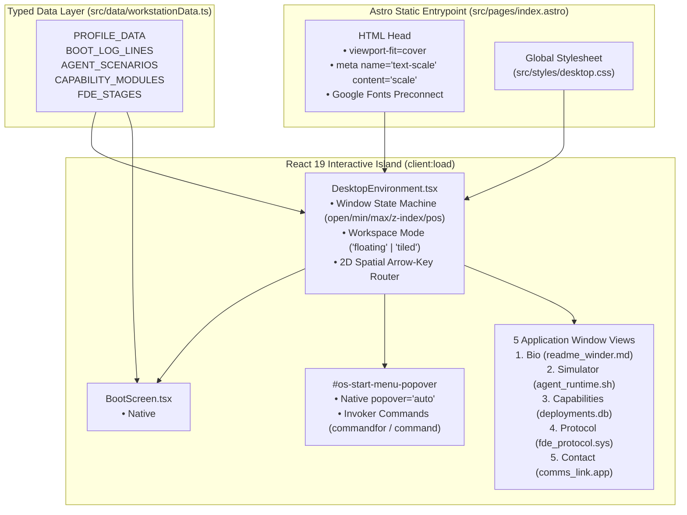

# WINDER//OS v5.0 — Forward Deployed AI Engineer Field Workstation

An interactive, retro-industrial desktop workstation portfolio (`WINDER//OS v5.0`) built for **Winder Segura**, Software Developer & Forward Deployed AI Engineer. Instead of a static scrolling landing page, this project presents an interactive operating system shell where visitors can explore live autonomous AI agent execution traces, enterprise architecture specifications, forward-deployment methodology, and a direct dispatch composer.

---

## Table of Contents

1. [Overview & Core Features](#overview--core-features)
2. [Technology Stack](#technology-stack)
3. [System Architecture](#system-architecture)
4. [How the Project Works](#how-the-project-works)
5. [Key Technical & Modern Web Decisions](#key-technical--modern-web-decisions)
6. [Getting Started](#getting-started)

---

## Overview & Core Features

- **BIOS / Kernel Boot Ceremony (`BootScreen.tsx`)**: A fast 2.3-second hardware initialization overlay with real-time subsystem checks, streaming kernel logs, and instant dismiss support via keyboard (`Enter`, `Space`, `Esc`), button click, or backdrop tap.
- **Dual-Mode Window Manager (`DesktopEnvironment.tsx`)**:
  - **Floating PC Desktop Mode**: Draggable, stackable (`z-index`), minimizable, and maximizable application windows with a desktop shortcut rail and bottom taskbar.
  - **Tiled Grid Showcase Mode**: One-click layout toggle (`Tile All`) that arranges all 5 workstation applications into a responsive CSS Grid for effortless reading.
- **5 Built-In Workstation Applications**:
  1. **`readme_winder.md` (Executive Profile)**: Concise presentation brief, field telemetry stats, and quick actions.
  2. **`agent_runtime.sh` (Live AI Agent Simulator)**: Interactive execution trace player demonstrating 3 real-world autonomous agent workflows (*ERP & Supply Chain Exception Agent*, *B2B Technical Support & Triage Agent*, and *Executive Revenue & Operations Copilot*) across `INGEST`, `REASON`, `TOOL_CALL`, `GUARDRAIL`, and `OUTPUT` phases.
  3. **`deployments.db` (Systems & Capabilities)**: Deep-dive architectural specs covering Multi-Agent Orchestration, Enterprise MCP/Tool Integration, and Zero-Trust Guardrail/Eval Harnesses.
  4. **`fde_protocol.sys` (FDE Playbook)**: The 4-stage Forward Deployed Engineering rollout timeline from Day 1 discovery to Week 4+ production handoff.
  5. **`comms_link.app` (Direct Dispatch Composer)**: One-click email copy, direct links, and an interactive workflow brief composer that pre-populates a structured deployment inquiry.

---

## Technology Stack

| Layer | Technology | Version | Purpose |
| :--- | :--- | :--- | :--- |
| **Meta-Framework** | [Astro](https://astro.build/) | `^5.5.0` | Static HTML shell generation, zero-overhead asset bundling, and island hydration (`client:load`). |
| **UI Runtime** | [React](https://react.dev/) | `^19.0.0` | Stateful window management, pointer dragging, live agent simulation timers, and spatial focus routing. |
| **Language** | [TypeScript](https://www.typescriptlang.org/) | `^5.7.0` | Strict domain typing for agent steps, scenarios, window state, and capability modules. |
| **Styling** | Modern Vanilla CSS | Baseline 2025/2026 | Custom design tokens, CSS Container Queries (`@container`), `cqi` fluid scaling, dynamic viewport units (`dvh`/`dvw`), and `field-sizing: content`. |
| **Icons** | [Lucide React](https://lucide.dev/) | `^0.487.0` | Crisp, lightweight hardware and telemetry iconography. |
| **Typography** | Google Fonts | — | `Space Grotesk` (display), `Plus Jakarta Sans` (body), and `JetBrains Mono` (terminal/telemetry). |

---

## System Architecture



### Directory Structure

```text
landing-page-example/
├── astro.config.mjs               # Astro + React integration config
├── package.json                   # Project scripts and dependencies
├── tsconfig.json                  # TypeScript configuration
└── src/
    ├── pages/
    │   └── index.astro            # Document shell, meta tags, font loading, and client:load mount
    ├── components/
    │   ├── BootScreen.tsx         # Modal <dialog> BIOS boot sequence component
    │   └── DesktopEnvironment.tsx # OS shell, window manager, spatial nav, and app views
    ├── data/
    │   └── workstationData.ts     # Strongly-typed profile, scenarios, capabilities, and FDE stages
    └── styles/
        └── desktop.css            # Design tokens, container queries, and responsive rules
```

---

## How the Project Works

### 1. Boot Sequence Lifecycle
When the page loads, `DesktopEnvironment` initializes with `isBooting = true` and mounts `BootScreen`.
- `BootScreen` opens a native `<dialog>` element in the browser's top layer via `dialog.showModal()`.
- A `35ms` interval advances the progress bar from `0%` to `100%` over `2.3s`, progressively revealing lines from `BOOT_LOG_LINES` and flipping the 4 hardware subsystem cards (`AGENT_ORCHESTRATOR`, `TOOL_SANDBOX_MCP`, `GUARDRAIL_ENGINE`, `DESKTOP_SHELL_UI`) to their ready states.
- Users can skip the sequence at any time by pressing `Enter`, `Space`, `Escape`, clicking the backdrop, or clicking **Enter Desktop Now**.

### 2. Window State & Pointer Dragging Engine
Each of the 5 apps is represented in `windows: Record<WindowId, WindowConfig>` with its own `isOpen`, `isMinimized`, `isMaximized`, `zIndex`, `position: { x, y }`, and `width`.
- **Focusing**: Clicking or tapping any window calculates `Math.max(...zIndex) + 1` and promotes that window to the front.
- **Dragging**: Pressing pointer-down on `.os-window-titlebar` (while in `floating` mode and not maximized) records the pointer coordinates and initial window offset in a `useRef`. Global `pointermove` and `pointerup` listeners update `position.x` and `position.y` smoothly while clamping coordinates within the viewport bounds so windows can never be dragged off-screen.
- **Responsive Collapse**: On viewports `<= 64em` (`1024px`) or when `workspaceMode === 'tiled'` is active, windows automatically transition from absolute floating coordinates to a stacked or responsive CSS Grid flow.

### 3. Live Agent Execution Simulator
Inside `agent_runtime.sh`, selecting any of the 3 `AGENT_SCENARIOS` resets `activeStepIndex` to `0` and sets `isSimRunning = true`.
- A reactive `useEffect` steps through each phase (`INGEST` -> `REASON` -> `TOOL_CALL` -> `GUARDRAIL` -> `OUTPUT`) every `420ms`.
- Active steps highlight in International Signal Orange (`#E84A27`), completed steps lock in Phosphor Mint (`#6EE787`), and once all steps finish, the ROI summary banner illuminates.

---

## Key Technical & Modern Web Decisions

This project was engineered and audited using modern web platform primitives to maximize accessibility, responsiveness, and resilience without heavy third-party UI libraries:

1. **Component-Driven Responsiveness with CSS Container Queries (`@container` & `cqi`)**
   - Because windows in `WINDER//OS` can be resized, tiled side-by-side, or maximized independently of the browser viewport width, internal window layouts (`.bio-stats-grid`, `.win-caps-body`, `.protocol-timeline`, `.contact-direct-cards`) use **CSS Container Queries** (`container: os-window / inline-size`).
   - Typography and window padding scale smoothly relative to each window's inline size using `clamp()` and `cqi` units inside `@supports (font-size: 1cqi)`, keeping maximum font sizes `<= 2.5x` the minimum to satisfy **WCAG 1.4.4 Resize Text (200% zoom)**.
   - Mobile-first stacked defaults and `em`-based `@media` queries provide progressive enhancement fallbacks.

2. **OS-Level Accessibility Text Scaling (`<meta name="text-scale" content="scale">`)**
   - Opts into native operating system font scaling in `index.astro` without overriding the root `html` or `:root` `font-size`.
   - Fixed pixel heights on the top menubar and bottom taskbar were replaced with `min-block-size` and flexible grid tracks (`grid-template-rows: auto minmax(0, 1fr) auto`) so bars expand gracefully when OS text scale is increased.

3. **Dynamic Viewport Units (`dvh` / `dvw`) & Safe-Area Insets**
   - Uses `100dvh` / `100dvw` (with `100vh` fallback) and `viewport-fit=cover` paired with `env(safe-area-inset-*)` padding on edge-anchored bars and modals so mobile browser address bars, notches, and home indicators never clip controls.
   - Enforces a minimum `24x24px` target size on pointer devices and `44x44px` on touch screens (`@media (pointer: coarse)`), using pseudo-element (`::after`) hit-area extensions on compact window titlebar buttons.

4. **Native Top-Layer `<dialog closedby="any">` & Declarative Popover API**
   - The boot screen uses a genuine `<dialog closedby="any">` opened with `showModal()` for native top-layer promotion, focus trapping, and platform close requests (`Esc`, mobile back gesture, light-dismiss).
   - The Start Menu uses the native `popover="auto"` attribute and **Invoker Commands API** (`commandfor="os-start-menu-popover"` `command="toggle-popover"`), with feature-detected dynamic imports for `@oddbird/popover-polyfill` and `invokers-polyfill` on older browsers.

5. **2D Spatial Arrow-Key Navigation & Roving Tabindex**
   - Composite widgets (`role="tablist"` on Simulator tabs, Capabilities sidebar, and Taskbar tabs; `role="listbox"` on the Desktop Icon Rail) implement the **Roving Tabindex Pattern** (`tabIndex={0}` on the active item, `-1` on inactive items).
   - Pressing arrow keys evaluates live visual geometry via `getBoundingClientRect()` and `checkVisibility()`, prioritizing perpendicular-axis overlap so arrow keys work seamlessly whether items are arranged horizontally, vertically, or wrapped across rows—while preserving native viewport scrolling when no candidate exists in the pressed direction.

6. **Auto-Growing `<textarea>` (`field-sizing: content`) & IME-Safe Submission**
   - The contact composer's `<textarea>` uses `field-sizing: content` with `width: 100%`, `min-block-size: 3lh`, and `max-block-size: 10lh` so it expands automatically as the user types without horizontal layout shifts.
   - Pressing `Enter` (`!e.shiftKey`) submits the form via `requestSubmit()`, guarded by `e.nativeEvent.isComposing || e.keyCode === 229` so users composing text with CJK Input Method Editors (IMEs) in Safari or Chromium never trigger premature form submission when confirming character candidates.

---

## Getting Started

### Prerequisites
- **Node.js** `>= 18.17.1` (or `>= 20.3.0`)
- **npm** `>= 9.x`

### Installation & Local Development

```bash
# Install dependencies
npm install

# Start the local Astro dev server (http://localhost:4321)
npm run dev
```

### Production Build & Preview

```bash
# Type-check and build static production bundle into ./dist
npm run build

# Preview the production build locally
npm run preview
```
